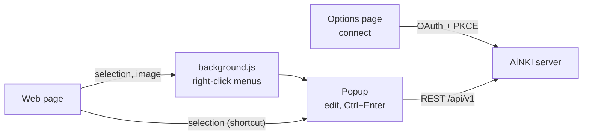

# AiNKI for Firefox

Turn what you read into flashcards. Select text or right-click an image on any page, write the question, and the card lands in your [AiNKI](https://github.com/vdTwer/AiNKI) deck with a link back to the page.

## Features

- **Connect once.** The extension signs in the way Claude does: OAuth with PKCE, and you allow it on AiNKI's own page. It shows up under Settings → Connected apps, where you can disconnect it.
- **Selection to card.** Select text and press <kbd>Alt+Shift+A</kbd>, click the toolbar button, or right-click → *Add selection to AiNKI*. The selection fills the back; you write the front.
- **Image to card.** Right-click an image → *Add image to AiNKI*, and put it on the front or the back.
- **Never saved by accident.** A card is created only when you press *Add card* or <kbd>Ctrl+Enter</kbd>. A plain Enter is a new line.
- **Remembers.** Your last deck, and your unsaved draft if the popup closes.
- **Source link.** Every card ends with `Source: [page title](url)`.
- **Clear feedback.** "Added to Birds." or the reason it failed; the draft stays until it is saved.

## How it works



Plain ES modules with JSDoc types, no build step, no npm. `src/lib` holds the logic (`oauth.js`, `api.js`, `card.js`), tested with Node's built-in runner.

## Install for development

1. Open `about:debugging#/runtime/this-firefox` → *Load Temporary Add-on…* → pick `manifest.json`.
2. The options page opens. Enter your AiNKI address and click *Connect*. Needs Firefox 128 or later and an AiNKI server with the REST API (`/api/v1`, including `POST /api/v1/images`).

Run the tests:

```sh
node --test test/*.test.js
```

## Releasing

Raise `version` in `manifest.json` and merge to main. The `release` workflow then signs the extension on addons.mozilla.org (unlisted) and publishes a GitHub release with `ainki.xpi` and `updates.json`. Installed copies find the new version through `update_url`, and AiNKI's *Get the extension* button always links to the latest release:

```
https://github.com/vdTwer/AiNKI-Extension/releases/latest/download/ainki.xpi
```

One-time setup: create an API key at addons.mozilla.org → Developer Hub → Tools → Manage API Keys, and add it to the repository secrets as `AMO_JWT_ISSUER` and `AMO_JWT_SECRET`.
